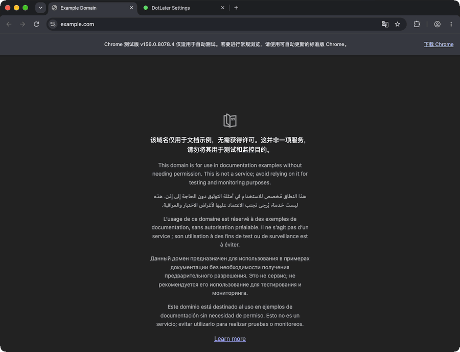

#  DotLater

**One dot. One click. Come back later.**

A lightweight, open-source tab reminder for Microsoft Edge.

| Not marked | Marked for later |
| :---: | :---: |
|  |  |

Click the dot or press **Ctrl + Shift + X** (**⌘ + Shift + X** on Mac) to toggle the mark. Returning to the tab clears it after **1 second** by default.

## Quick Start

**[Website & getting started guide](https://the-aries.github.io/dotlater/)**

| Install method | Get started |
| --- | --- |
| Microsoft Edge Add-ons | [Install DotLater from the official Edge store](https://microsoftedge.microsoft.com/addons/detail/dnockdnebimcohmnhgijdmphfjacldan) |
| GitHub Release (manual) | [Download v1.0 ZIP](https://github.com/The-Aries/dotlater/releases/download/v1.0/DotLater-v1.0.zip), then follow the [installation steps](docs/GUIDE.md#quick-start) |

*Recorded in Microsoft Edge: find DotLater in the Extensions menu, use its toolbar dot, and revisit marked tabs.*

**Pin DotLater to your toolbar:** open your browser's **Extensions** menu (puzzle-piece icon) and select **Show in toolbar** or **Pin** next to DotLater. Then click its green dot to mark the current tab. Click again to unmark, or return to the tab to clear the mark automatically.

## Documentation

| Document | Contents |
| --- | --- |
| [Usage & Settings](docs/GUIDE.md) | Mark tabs, shortcuts, options, installation |
| [Privacy](docs/PRIVACY.md) | Data and permissions |
| [Development & Credits](docs/DEVELOPMENT.md) | Source, tests, attribution |

Found a bug or want another browser supported? [Open an issue](https://github.com/The-Aries/dotlater/issues) or submit a pull request.

## Sponsor

Support this free project on [GitHub Sponsors](https://github.com/sponsors/The-Aries). One-time and monthly contributions are available.

## License

[MIT](LICENSE) · **v1.0** · Edge first · No accounts or analytics.
