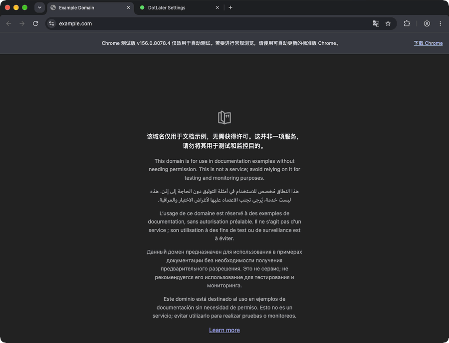

# Usage

## Mark tabs

| Action | Result |
| --- | --- |
| Click the **green dot** | Mark for later; toolbar turns yellow |
| Click the **yellow dot** | Remove mark; toolbar turns green |
| Press **Ctrl + Shift + X** (Windows/Linux) or **⌘ + Shift + X** (Mac) | Toggle the mark |
| Switch away, then return for **1 second** | Automatically clear the mark |

The tab's favicon also becomes a yellow dot **when Edge allows the page to be modified**. Tabs that cannot run the content script (such as the built-in PDF viewer) can still be marked by the toolbar dot. Marks apply to individual tabs.

## Settings

Open **DotLater → Extension options** in `edge://extensions`.

**Auto-clear on return:** Immediately · 1 second (default) · 2 seconds · 5 seconds · Manual only.

**Custom shortcut:** Open `edge://extensions/shortcuts`.

**Local HTML files:** If you want the actual tab favicon to change for `file://` pages, turn on **Allow access to file URLs** under DotLater's Edge extension details. Without this permission, you can still use the toolbar-only mark.

## Quick Start

| Method | How |
| --- | --- |
| **Microsoft Edge Add-ons** | The extension has been approved; the public listing link will be added after it is confirmed |
| **GitHub Releases** | [Download v1.0 ZIP](https://github.com/The-Aries/dotlater/releases/download/v1.0/DotLater-v1.0.zip), extract it, open `edge://extensions`, enable **Developer mode**, choose **Load unpacked** and select the extracted folder containing `manifest.json` |

The public Edge store listing URL has not yet been confirmed. The GitHub Release provides manual installation files; the source repository can also be loaded unpacked for development. See [Development](DEVELOPMENT.md).

**After installation:** Open the browser Extensions menu (puzzle-piece icon), find DotLater, and choose **Show in toolbar** or **Pin**. Pinning is optional; the keyboard shortcut also works without it.

## Limits

- Ordinary web pages and local HTML can show the yellow **tab favicon**. Local files require Edge file-URL access.
- **Safari:** it may not refresh a favicon changed by an extension. DotLater instead prefixes marked page titles with `🟡`, removing the prefix on unmark or auto-clear. Safari may delay updating the visible title until the tab is switched. Its sidebar is not a native vertical tab strip.
- PDFs and protected Edge pages may only show the yellow **toolbar dot**, because Edge does not allow extensions to change their page contents. Where Edge disables the extension action entirely, no mark can be applied.
- Closing a tab or ending the browser session removes its mark. Navigating to a different URL also clears it.
- Chrome and Firefox have passed extension-function tests on recent stable releases. Safari uses the title-prefix fallback described above; its store package is not yet published.
